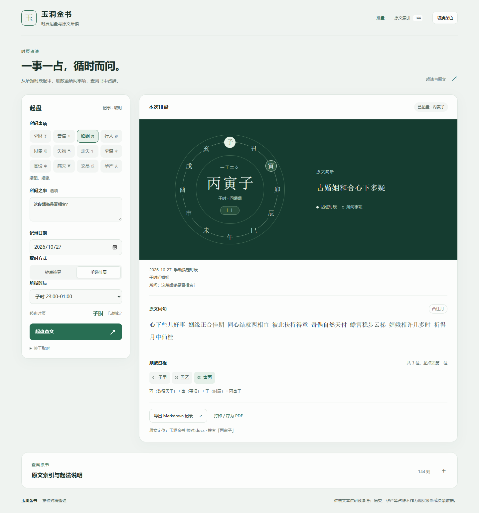

# 玉洞金书排盘

一个依据《玉洞金书》校对稿制作的时辰排盘与原文查阅工具。选择所问事项和时辰，程序会按书中的方法顺数，显示三字卦名、推算过程和对应的完整占辞。

**[在线使用](https://shannonzzzz.github.io/yudong-jinshu/)** · [起算流程 SOP](assets/算卦流程SOP.md) · [开源许可](LICENSE)



## 功能

- 覆盖十二时辰与十二类事项，共 144 种组合。
- 显示三字卦名、十二地支示意、逐位顺数、原文等级、词句及简断。
- 支持按北京时间钟点换算时辰，也可以直接指定时辰。
- 可按卦名、词句或简断搜索原文，并导出 Markdown 记录或打印为 PDF。
- 支持手机页面、键盘操作，以及浅色和深色主题。
- 纯静态实现：计算和检索在浏览器本地完成。问事内容不会由本程序发送到服务器，也不会自动保存；关闭或刷新前请先导出需要保留的记录。

## 如何使用

1. 选择所问事项，例如“婚姻”；可选填具体问题。
2. 填写记录日期，并选择钟点换算或手选时辰。
3. 点击“起盘查文”，先读简断，再对照词句和顺数过程。
4. 需要保留时，选择“导出 Markdown 记录”或“打印 / 存为 PDF”。

点击页面顶部“原文索引”可搜索 144 则原文；点击某条后，页面会按对应的事项和时辰起盘。

也可以下载仓库，直接双击 `docs/index.html` 离线使用。无需安装依赖、启动服务或连接网络。

## 起算方法

以所报时辰地支为起点，该位起甲；按“子丑寅卯辰巳午未申酉戌亥”顺数，天干“甲乙丙丁戊己庚辛壬癸”循环，数到所问事项对应的地支为止。

**三字卦名 = 数得天干 + 事项地支 + 所报时辰地支。**

例如子时问婚姻，婚姻对应寅：子甲、丑乙、寅丙，得到 **丙寅子**。子时问交易数到戌，共十一位，天干重新回到甲，得到 **甲戌子**。

原稿未详细说明取时规则。本程序提供的钟点换算使用北京时间（UTC+08:00）及常见双小时制，例如子时为 23:00 至次日 01:00；不作真太阳时校正。记录日期不参与起算。

## 项目结构

```text
docs/index.html        可直接打开的单文件页面，也是 GitHub Pages 入口
src/core.js            起算、时辰换算与记录导出
src/ui.js              页面交互
src/style.css          页面样式
src/template.html      页面模板
src/data.json          原文索引与占辞数据
scripts/build.py       生成单文件页面
tests/                 核心、构建和浏览器验证
assets/                界面预览与流程 SOP
```

## 开发与验证

日常使用无需依赖。修改源文件后，可用 Python 3 重新生成页面，并使用 Node.js 验证起算：

```bash
python scripts/build.py
python scripts/build.py --check
node tests/verify_core.cjs
python tests/verify_build.py
```

核心验证以原文的 144 个标题和具体算例作为预期，覆盖天干循环、跨亥回子、钟点边界、非法输入及记录导出。构建验证比较生成页面和源文件中的数据。

如需运行浏览器交互测试，先安装 Python 版 Playwright 及其 Chromium：

```bash
python -m pip install playwright
python -m playwright install chromium
python tests/verify_browser.py
```

也可通过 `YUDONG_BROWSER_EXECUTABLE` 环境变量指定兼容的 Chromium 浏览器。浏览器测试会在 `.test-output/` 生成截图和导出样本。

## 原文与使用边界

占辞数据依据项目使用的《玉洞金书 校对.docx》整理，保留原稿词句和简断。校对稿本身的来源及相关权利状态尚未核实；仓库没有附带该 Word 文件。词句和简断有分歧时，程序保留原样，例如“乙午未”条目的时日表述。

本项目用于传统文本研读。病灾、孕产、财务等占辞不构成专业判断，也不应作为指认他人的证据。

## 许可

本项目自行编写的程序代码按 [MIT License](LICENSE) 开源。古籍原文及校对文本不因本许可证而被声明为 MIT 授权，其权利状态请另行核实。
